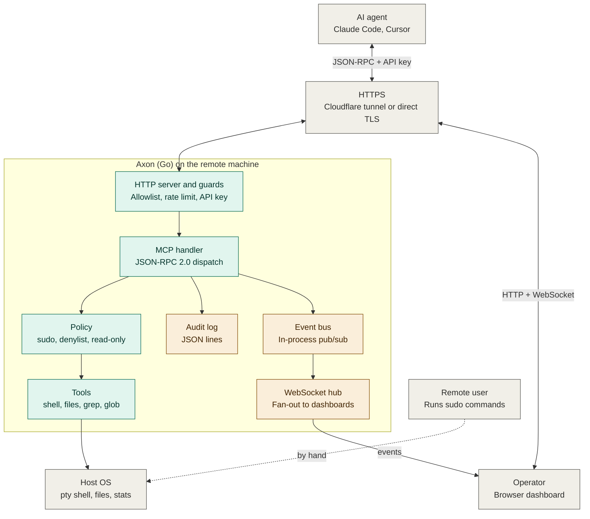
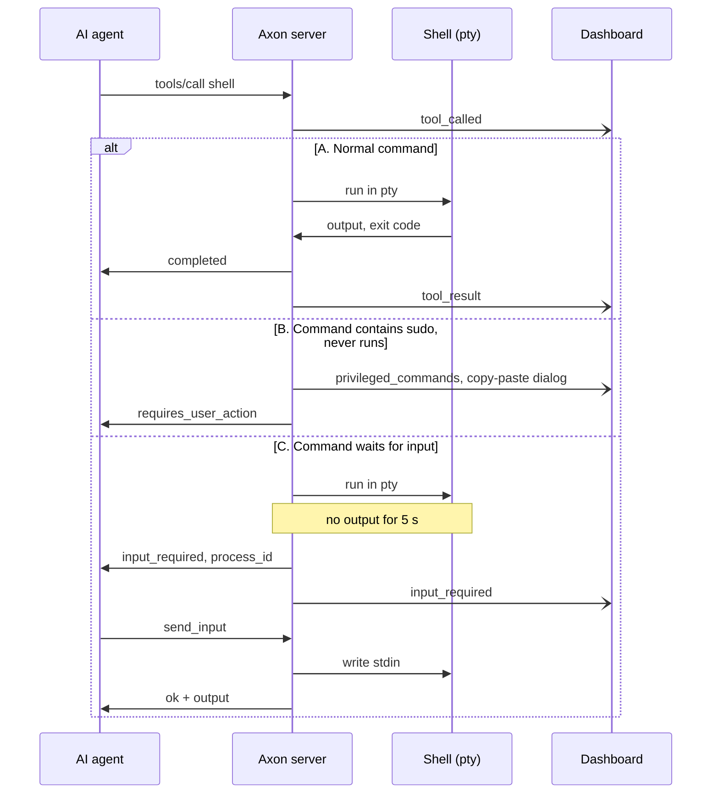

# Architecture

Axon is one Go binary. It runs on a remote machine and exposes that machine's shell and files to an AI agent through the Model Context Protocol (MCP). It also serves a web dashboard. The dashboard shows what the agent does.

This document shows the parts of Axon, the actors, and how data moves between them. For setup, see [README.md](README.md). For build and test commands, see [CLAUDE.md](CLAUDE.md).

## Actors

| Actor | What it does |
|---|---|
| AI agent | Claude Code, Cursor or another MCP client. It sends `tools/call` requests with the API key. It does not have the operator key. |
| Operator | A person with the dashboard open in a browser. The operator holds the operator key. The operator watches activity, answers `input_required` prompts and cancels commands. |
| Remote user | The person who owns the remote machine. This person runs `sudo` commands by hand. Axon never runs them. |
| Cloudflare | Optional. `cloudflared` gives Axon a public HTTPS URL without port forwarding. |

## Technology stack

| Layer | Technology | Code |
|---|---|---|
| Transport | TLS with a self-signed certificate, or plain HTTP on `127.0.0.1` behind a Cloudflare tunnel | `internal/security/tls.go`, `internal/tunnel` |
| HTTP server | Go 1.25 `net/http` with method-aware `ServeMux` routes | `internal/server` |
| Guards | IP allowlist, per-IP rate limit (`golang.org/x/time/rate`), constant-time key check (API key for `/mcp`, operator key for the dashboard) | `internal/security` |
| MCP | JSON-RPC 2.0 over `POST /mcp` | `internal/mcp` |
| Tools | Shell in a pty (`creack/pty`), file tools, `grep`, `glob`, host stats (`gopsutil`) | `internal/tools` |
| Events | In-process pub/sub and a WebSocket hub (`gorilla/websocket`) | `internal/events`, `internal/hub` |
| Audit | JSON lines file, mode `0600` | `internal/audit` |
| Configuration | YAML in `~/.axon/`, with embedded defaults | `internal/config`, `internal/paths` |
| Dashboard | React 19, Tailwind 4, Vite, tested with Vitest. Embedded in the binary with `go:embed`. | `web/`, `internal/dashboard` |

## System overview

Green boxes are the request path. Amber boxes are the event and audit path. Gray boxes are actors, transport and the host.

### What the diagram shows

**Request path**

1. The agent sends a JSON-RPC request to `POST /mcp` with `Authorization: Bearer <API key>`.
2. The request reaches Axon over HTTPS. In tunnel modes, `cloudflared` receives the request and forwards it to `http://127.0.0.1:<port>`.
3. The HTTP server checks the IP allowlist and the rate limit. The handler then checks the key for that route: the API key for `/mcp`, the operator key for `/ws` and `/api/*`. Any failure ends the request.
4. The MCP handler reads the method: `initialize`, `tools/list` or `tools/call`.
5. For `shell`, the policy checks run in this order:
   - A command that contains `sudo` never runs. It goes to the dashboard.
   - In read-only mode, the shell is disabled.
   - A command that contains a denylist pattern is blocked.
6. The tool runs on the host: a pty shell, a file read or write, `grep`, `glob`, or a host stats query.
7. The result returns to the agent in the same HTTP response.

**Event and audit path**

1. The MCP handler writes one audit log line for each tool call.
2. It also publishes events to the event bus: `tool_called`, `tool_result`, `input_required` and `privileged_commands`.
3. The WebSocket hub reads the bus and sends each event to every connected dashboard. The hub also sends `system_stats` every 5 seconds.
4. The bus never blocks. A subscriber with a full buffer (64 events) loses events.

**Dashboard**

- The operator opens `/#<operator key>`. The page stores the key in `sessionStorage`, removes it from the URL, and opens `GET /ws?key=<operator key>`.
- The dashboard calls `POST /api/input` and `POST /api/cancel` with the operator key as a Bearer token. The API key does not work on these routes, and the operator key does not work on `/mcp`.
- The dashboard reads the API key from `GET /api/agent-config` (operator key only) to show the agent's setup snippet.
- The static dashboard files (`GET /`) and `GET /health` need no key and have no allowlist or rate limit.

**Human step**

The remote user reads each `sudo` command in the dashboard. The remote user then runs it in a terminal.

## Shell call sequence

### What the diagram shows

Every call starts the same way. The agent sends `tools/call` and Axon publishes `tool_called`. Then one of three cases applies.

**A. Normal command.** Axon runs the command in a pty and waits for it to finish. It returns `completed` with the output and the exit code. It then publishes `tool_result`.

**B. Command contains `sudo`.** Axon does not run the command. It publishes `privileged_commands`, and the dashboard shows a copy-paste dialog. The agent gets `{"status":"requires_user_action"}`. This check is a guardrail, not a security boundary. A path such as `/usr/bin/sudo` is caught, but a script that calls `sudo` is not.

**C. Command waits for input.** If the command prints nothing for `input_stall_seconds` (default 5), Axon returns `input_required` with a `process_id`. The command keeps running. Its lifetime does not depend on the HTTP request. It ends when one of these happens:

- The command finishes.
- The agent calls `cancel_command`, or the operator cancels it in the dashboard.
- `shell_timeout` (default 5 minutes) expires.

The agent continues with `send_input` and the `process_id`. Axon writes the data to the pty and returns the output so far. The operator can also answer from the dashboard with `POST /api/input`. If that answer ends the command, the agent still reads the result. Axon keeps the final output and exit code for 2 minutes. The agent calls `send_input` with empty data to get them. After 2 minutes, `send_input` returns an error.

## Operator secrets

The operator can type a password in the dashboard when a command waits for input. The password must reach the command and nothing else.

1. The dashboard shows a masked field. The `Secret` box is on by default.
2. The dashboard sends `POST /api/input` with the operator key and `secret: true`. The server treats a missing `secret` as `true`. Only the operator key reaches this route. If the agent could call it, the agent could register words of its choice and hide them from the audit log and the events.
3. Axon registers each typed line in one secret store, then writes the text to the pty. Only a live process can register a secret: an unknown or ended process registers nothing. The store belongs to the process manager, so it covers all processes. A secret lasts as long as its process, then 10 minutes. The order matters: no output exists that could show the text before it is registered.
4. Everything the agent or the dashboard can read passes the store, and the store replaces the text with `[redacted]`:
   - the output of every `shell` call, also of other commands that run later
   - the `send_input` result and the stored final result
   - the result of `read_file`, `grep` and `glob`, and error messages
   - the details in dashboard events
   - the audit log
5. The store also replaces the JSON-escaped form of the text. Output is often encoded after it is built. A quote or a backslash in a password looks different once encoded.
6. The audit log records only the process id for the operator's input. The `dashboard_input` event carries the process id, the IP address and the `secret` flag. Neither carries the text.

Why one store for all processes: a program can write the text to a file or a log. The agent can read that file with a new command. A store for each process would miss it.

Limits. The protection is best effort:

- Axon replaces exact text. A changed copy of the secret (a hash, base64, or terminal redraw codes inside the text) is not replaced.
- The store replaces the text everywhere, also in ordinary output. A short secret such as `root` makes other output hard to read. This is the cost of the `Secret` box.
- The text is no longer replaced 10 minutes after its process ends.
- A hostile agent that can run commands as the Axon user has other ways to read a process, for example `ptrace` or `/proc`. Run Axon as a dedicated user and keep `ptrace_scope` at 1 or higher. The `Secret` box stops accidental exposure, not an attacker.
- In tunnel mode, Cloudflare handles the traffic between the browser and Axon.
- A plain response (the `Secret` box off) reaches the agent on purpose.

## Events

| Event | Sent when |
|---|---|
| `connected` | A dashboard opens its WebSocket |
| `tool_called` | A `tools/call` request starts |
| `tool_result` | A tool call ends |
| `input_required` | A shell command stalls and waits for input |
| `privileged_commands` | A shell command contains `sudo` |
| `dashboard_input`, `dashboard_cancel` | The operator sends input or cancels from the dashboard. `dashboard_input` never contains the text. |
| `system_stats` | Every 5 seconds |

## Trust and limits

- There are two credentials. The API key runs any command that the Axon user can run. The operator key controls the dashboard: it answers prompts, registers secrets, cancels commands and reads the API key. Keep the operator key away from the agent.
- The denylist and the `sudo` check are guardrails. A client can bypass them. Run Axon as an unprivileged user without passwordless `sudo`.
- In tunnel modes, every request comes from `127.0.0.1`. The IP allowlist and the per-IP rate limit cannot tell clients apart.

See [Security notes](README.md#security-notes) for the full list.
