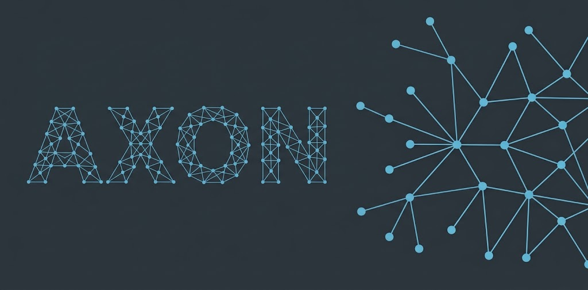

Axon is a standalone Go agent. It exposes an [MCP](https://modelcontextprotocol.io) (Model Context Protocol) API over HTTPS. An AI coding agent uses this API to run shell commands and to read or edit files on a remote machine.

- [Features](#features)
- [Install](#install)
- [Quick start](#quick-start)
- [Connect an AI agent](#connect-an-ai-agent)
- [Dashboard](#dashboard)
- [Cloudflare Tunnel](#cloudflare-tunnel)
- [Local development](#local-development)
- [Commands](#commands)
- [Configuration](#configuration)
- [MCP tools](#mcp-tools)
- [Security notes](#security-notes)
- [License](#license)

## Features

- API key authentication (`Authorization: Bearer axon_k_...`)
- Optional IP allowlist and per-IP rate limiting
- Command denylist and read-only mode
- Interactive commands: a command that waits for input returns `input_required`. Use `send_input` or `cancel_command` to continue.
- Secret input: a password that you type in the dashboard goes to the command. Axon replaces that text with `[redacted]` in everything the agent can read, in the dashboard and in the logs. This is best effort. See [Security notes](#security-notes).
- Audit log (JSON lines) for every tool call
- Web dashboard with a live view of agent activity
- Refuses to run as root. Commands that contain `sudo` never run. The dashboard shows them so that you can run them yourself.
- Optional Cloudflare tunnel for access without port forwarding

## Install

```bash
# With the Go toolchain (Go 1.25 or later)
go install github.com/chrisvoo/axon/cmd/axon@latest

# Linux or macOS: installs to ~/.local/bin/axon
curl -fsSL https://raw.githubusercontent.com/chrisvoo/axon/main/scripts/install.sh | bash
```

```powershell
# Windows (PowerShell): installs to %LOCALAPPDATA%\axon\bin
irm https://raw.githubusercontent.com/chrisvoo/axon/main/scripts/install.ps1 | iex
```

Set `AXON_REPO` to install from a fork. On Windows, set `AXON_VERSION` to a release tag to pin a version.

To build from a clone:

```bash
git clone https://github.com/chrisvoo/axon.git && cd axon
go build -o axon ./cmd/axon   # uses the committed dashboard build
make build                    # also rebuilds the dashboard (needs pnpm)
```

## Quick start

On the remote machine:

```bash
axon init    # creates ~/.axon/ with the API key, TLS certificate and denylist
axon serve   # listens on https://0.0.0.0:8443/mcp
```

`axon serve` prints the API key, the TLS fingerprint and ready-to-paste client configuration. It also opens the dashboard in your browser. Use `-no-browser` to skip this.

> **TLS:** the generated certificate is self-signed and valid only for `localhost` and `127.0.0.1`. A remote client cannot verify it. Use a [Cloudflare tunnel](#cloudflare-tunnel), or set `cert_file` and `key_file` to your own certificate.

## Connect an AI agent

Use the values from `axon serve` on the machine where your agent runs.

**Claude Code**

```bash
claude mcp add axon --transport http "https://YOUR_REMOTE_HOST:8443/mcp" \
  -H "Authorization: Bearer axon_k_..."
```

**Cursor and other clients** — add this to the MCP configuration file (for Cursor: `.cursor/mcp.json`):

```json
{
  "mcpServers": {
    "axon": {
      "url": "https://YOUR_REMOTE_HOST:8443/mcp",
      "headers": { "Authorization": "Bearer axon_k_..." }
    }
  }
}
```

`axon serve` and the dashboard also give a `cursor://` [install link](https://cursor.com/docs/context/mcp/install-links). The link contains your API key. Treat it as a secret.

Restart the agent after you change its MCP configuration.

## Dashboard

The dashboard is at the origin of the server, for example `https://YOUR_REMOTE_HOST:8443/` (not `/mcp`). Enter the same API key to connect. With the self-signed certificate, accept the browser warning first.

The dashboard lists the commands from the agent, newest first. If a command needs `sudo`, a dialog shows the command for you to copy and run.

## Cloudflare Tunnel

A Cloudflare tunnel gives the remote machine a public HTTPS URL. You do not need port forwarding, a public IP or a certificate. [`cloudflared`](https://github.com/cloudflare/cloudflared/releases) must be in `PATH`.

Tunnel modes serve plain HTTP on `127.0.0.1`. `cloudflared` provides the public HTTPS endpoint.

**Quick tunnel** (no account, temporary URL):

```bash
axon serve -tunnel
```

Axon starts `cloudflared` and prints the client configuration for the new `trycloudflare.com` URL. The URL changes on every restart.

**Named tunnel** (permanent URL). Set up once, on the remote machine. You need a domain on Cloudflare DNS.

```bash
cloudflared tunnel login                                        # saves ~/.cloudflared/cert.pem
cloudflared tunnel create axon-mcp                              # prints the tunnel UUID
cloudflared tunnel route dns axon-mcp axon.yourdomain.com

cat > ~/.cloudflared/config.yml <<'EOF'
tunnel: axon-mcp
credentials-file: /home/<you>/.cloudflared/<uuid>.json
ingress:
  - hostname: axon.yourdomain.com
    service: http://localhost:8443
  - service: http_status:404
EOF
```

Replace `<you>` with your user name and `<uuid>` with the UUID from the second command. Then start Axon:

```bash
axon serve -tunnel-name axon-mcp -tunnel-url https://axon.yourdomain.com
```

## Local development

Run Axon on your own machine over plain HTTP. No certificate is needed.

```bash
axon init
axon serve -dev     # or: make dev
```

`-dev` always binds to `127.0.0.1` and prints the client configuration for `http://127.0.0.1:8443/mcp`.

To work on the dashboard without a server, run it with fake events:

```bash
cd web && VITE_DEMO_MODE=true pnpm dev
```

## Commands

| Command | Description |
|---|---|
| `axon init` | Create the config, API key, TLS certificate and denylist |
| `axon serve` | Start the HTTPS MCP server |
| `axon serve -dev` | Plain HTTP on `127.0.0.1`, for local development |
| `axon serve -tunnel` | Start a Cloudflare quick tunnel (implies `-dev`) |
| `axon serve -tunnel-name N -tunnel-url U` | Start a named Cloudflare tunnel (implies `-dev`) |
| `axon serve -addr A -port P` | Override the listen address and port |
| `axon serve -no-browser` | Do not open the dashboard |
| `axon status` | Show the config paths and the certificate fingerprint |
| `axon keygen` | Rotate the API key |
| `axon version` | Print the version |

## Configuration

Axon merges `~/.axon/config.yaml` over the built-in defaults.

| Key | Default | Meaning |
|---|---|---|
| `listen_addr`, `listen_port` | `0.0.0.0`, `8443` | Where the server listens |
| `ip_allowlist` | empty | Allowed IPs or CIDRs. Empty allows any IP. |
| `rate_limit_rps` | `20` | Requests per second per IP. `0` disables the limit. |
| `shell_timeout` | `5m` | Maximum run time of a shell command |
| `input_stall_seconds` | `5` | Seconds without output before `input_required` |
| `read_only` | `false` | `true` disables `shell`, `write_file` and `edit_file` |
| `audit_log` | `audit.log` | Audit log path (relative to `~/.axon/`) |
| `denylist_file` | `denylist.txt` | Blocked command patterns (relative to `~/.axon/`) |
| `cert_file`, `key_file` | `server.crt`, `server.key` | Your own TLS certificate |

## MCP tools

| Tool | Purpose |
|---|---|
| `shell` | Run a shell command (bash or sh on Unix, PowerShell or cmd on Windows). A command that contains `sudo` never runs. It returns `{"status":"requires_user_action"}` and the dashboard shows the command. |
| `read_file` | Read a file (optional 1-based line range) |
| `write_file` | Write or overwrite a file |
| `edit_file` | Replace a unique string in a file |
| `grep` | Regex search under a directory |
| `glob` | Find files by base-name pattern under a directory |
| `system_info` | Host, CPU, memory and disk summary |
| `send_input` | Send input to a process that returned `input_required` |
| `cancel_command` | Stop a tracked process |

## Security notes

- Treat the API key like a password. Rotate it with `axon keygen` if it leaks.
- Run Axon as an unprivileged user that has no passwordless `sudo`. The denylist and the `sudo` check are guardrails, not a sandbox. A client can bypass them, for example with `/usr/bin/sudo` or by writing a script and running it.
- The file tools can reach every path that the Axon user can reach.
- Secret input is hidden by exact-text replacement for 10 minutes, in the output of every tool (shell, files, search), the logs and the dashboard. It does not hide a changed copy of the secret (for example a hash). It does not stop a hostile agent that runs commands as the Axon user. In tunnel mode, Cloudflare handles the traffic between your browser and Axon, so a secret passes through its network.
- In tunnel mode, every request comes from `127.0.0.1`. `ip_allowlist` and the per-IP rate limit cannot tell clients apart.
- Prefer a VPN or an SSH tunnel if you cannot expose a port safely.
- Review and extend `~/.axon/denylist.txt` for your environment.

## License

MIT
