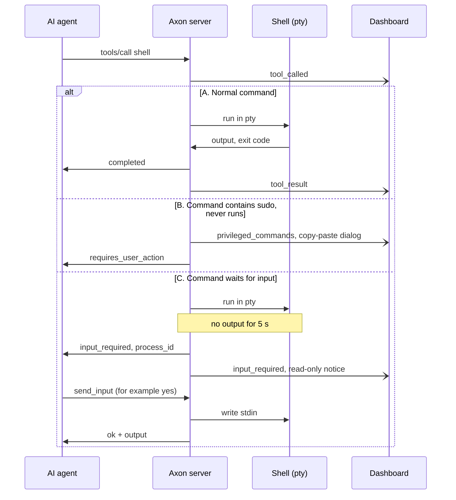

# Architecture

Axon is one Go binary. It runs on a remote machine and exposes that machine's shell and files to an AI agent through the Model Context Protocol (MCP). It also serves a web dashboard. The dashboard shows what the agent does. It does not control anything.

This document shows the parts of Axon, the actors, and how data moves between them. For setup, see [README.md](../README.md). For build and test commands, see [CLAUDE.md](../CLAUDE.md).

## Actors

| Actor | What it does |
|---|---|
| AI agent | Claude Code, Cursor or another MCP client. It sends `tools/call` requests with the API key. It runs commands, answers confirmation prompts with `send_input` and stops stalled commands with `cancel_command`. |
| Operator | A person with the dashboard open in a browser. The operator uses the same API key as the agent. The dashboard only watches: it has no input field and no cancel button. |
| Remote user | The person who owns the remote machine. This person runs `sudo` commands by hand. Axon never runs them. |
| Cloudflare | Optional. `cloudflared` gives Axon a public HTTPS URL without port forwarding. |

## Technology stack

| Layer | Technology | Code |
|---|---|---|
| Transport | TLS with a self-signed certificate, or plain HTTP on `127.0.0.1` behind a Cloudflare tunnel | `internal/security/tls.go`, `internal/tunnel` |
| HTTP server | Go 1.25 `net/http` with method-aware `ServeMux` routes | `internal/server` |
| Guards | Client address, IP allowlist, failed-key block, per-IP rate limit (`golang.org/x/time/rate`), constant-time check of the one API key | `internal/security` |
| MCP | JSON-RPC 2.0 over `POST /mcp` | `internal/mcp` |
| Tools | Shell in a pty (`creack/pty`), file tools, `grep`, `glob`, host stats (`gopsutil`) | `internal/tools` |
| Events | In-process pub/sub and a WebSocket hub (`gorilla/websocket`) | `internal/events`, `internal/hub` |
| Audit | JSON lines file, mode `0600` | `internal/audit` |
| Configuration | YAML in `~/.axon/`, with embedded defaults. It holds no API key. | `internal/config`, `internal/paths` |
| Dashboard | React 19, Tailwind 4, Vite, tested with Vitest. Read-only. Embedded in the binary with `go:embed`. | `web/`, `internal/dashboard` |

## System overview

![Axon architecture. The AI agent and the operator reach Axon over HTTPS. Both pass the shared guards: the client address, the IP allowlist, the failed-key block and the rate limit. The agent then passes the API key check on /mcp, the MCP handler, the policy and the tools. The operator passes the API key check on /ws and reaches the WebSocket hub. The MCP handler feeds the event bus and the audit log. The event bus feeds the hub, and the hub sends events to the dashboard. Nothing flows back from the dashboard.](../assets/axon-architecture.png)

Green boxes are the agent request path. Blue boxes are the dashboard path. Amber boxes are the event and audit path. Gray boxes are actors, the in-memory key and the host. The editable source is [assets/axon-architecture.svg](../assets/axon-architecture.svg).

### What the diagram shows

**Request path**

1. The agent sends a JSON-RPC request to `POST /mcp` with `Authorization: Bearer <API key>`.
2. The request reaches Axon over HTTPS. In tunnel modes, `cloudflared` receives the request and forwards it to `http://127.0.0.1:<port>`.
3. The HTTP server finds the client address. In tunnel modes, `cloudflared` runs on the same machine, so the peer is loopback. The server then reads the real address from `CF-Connecting-IP`. Without a tunnel, it ignores that header. The server checks the IP allowlist, the failed-key block and the rate limit for that address. The handler then checks the API key. A wrong key is an `auth_fail` audit line. After 5 in a row, the address is blocked for 60 seconds. The server caps the request body at 16 MiB. Any failure ends the request.
4. The MCP handler reads the method: `initialize`, `tools/list` or `tools/call`.
5. For `shell`, the policy checks run in this order:
   - A command that contains `sudo` never runs. It goes to the dashboard.
   - In read-only mode, the shell is disabled. `write_file` and `edit_file` are disabled too.
   - A command that contains a denylist pattern is blocked.
   - At 16 running commands, a new command returns an error.
6. The tool runs on the host: a pty shell, a file read or write, `grep`, `glob`, or a host stats query. The file tools refuse the Axon config folder and the audit log, denylist and TLS files.
7. The result returns to the agent in the same HTTP response.

**Event and audit path**

1. The MCP handler writes one audit log line for each tool call.
2. It also publishes events to the event bus: `tool_called`, `tool_result`, `input_required` and `privileged_commands`.
3. The WebSocket hub reads the bus and sends each event to every connected dashboard. The hub also sends `system_stats` every 5 seconds.
4. The bus never blocks. A subscriber with a full buffer (64 events) loses events.

**Dashboard**

- The operator opens the dashboard and pastes the API key. The page keeps it in `sessionStorage` for the life of the tab. A key in the address fragment also works. `axon serve` prints a clickable link with the key in the fragment. A browser never sends a fragment to the server, so no log sees it. Axon opens the browser without a key, so it never shows in the process list.
- The page opens `GET /ws` and offers two WebSocket subprotocols: `axon.v1` and `axon.key.<API key>`. The key travels in the `Sec-WebSocket-Protocol` request header. It is not in the URL, so it does not show in a proxy access log or in the browser history.
- Axon selects `axon.v1`. It never sends the key back.
- A missing or wrong key does not get an HTTP error. A browser cannot read the status of a failed handshake. Axon completes the handshake and closes the connection with code `4401` before it sends any event. The dashboard then asks for a new key.
- The dashboard sends nothing to Axon after the handshake. There is no other dashboard route.
- The key is new at every start. After a restart, the stored key is wrong, so the connection closes with `4401` and the dashboard asks for the new key. The link that `axon serve` prints has the new key.
- The WebSocket accepts a browser only from the same origin: the `Origin` host must equal the `Host` header.
- Every response carries a Content-Security-Policy (own script and CSS, Google Fonts, `connect-src 'self'`, no frames), `X-Frame-Options: DENY`, `X-Content-Type-Options: nosniff` and `Referrer-Policy: no-referrer`.
- The static dashboard files (`GET /`) and `GET /health` need no key and have no allowlist or rate limit.

**Human step**

The remote user reads each `sudo` command in the dashboard. The remote user then runs it in a terminal.

## Shell call sequence

### What the diagram shows

Every call starts the same way. The agent sends `tools/call` and Axon publishes `tool_called`. Then one of three cases applies.

**A. Normal command.** Axon runs the command in a pty and waits for it to finish. It returns `completed` with the output and the exit code. It then publishes `tool_result`.

**B. Command contains `sudo`.** Axon does not run the command. It publishes `privileged_commands`, and the dashboard shows a copy-paste dialog. The agent gets `{"status":"requires_user_action"}`. This check is a guardrail, not a security boundary. A path such as `/usr/bin/sudo` is caught, but a script that calls `sudo` is not. The word in a comment or in quoted text that the shell does not run (`echo "needs sudo"`) is ignored. Nothing is ignored when the command has a heredoc or a word that runs text (`sh`, `bash`, `eval`, `ssh`, `xargs`, `exec`, `env`, `watch`, `su`, `python*`, `perl`, `awk` and others). Quoted text in command position (`"sudo" id`) is still checked. Once a double-quoted string holds `$(` or a backtick, nothing after it is ignored.

**C. Command waits for input.** If the command prints nothing for `input_stall_seconds` (default 5), Axon returns `input_required` with a `process_id`. The command keeps running. Its lifetime does not depend on the HTTP request. It ends when one of these happens:

- The command finishes.
- The agent calls `cancel_command`.
- `shell_timeout` (default 5 minutes) expires.

The agent continues with `send_input` and the `process_id`. Axon writes the data to the pty and returns the output so far. The agent can answer a confirmation prompt by itself, for example `yes` for `Do you want to continue? [Y/n]`. No person takes part. A command can also end before the agent calls `send_input`. Axon keeps the final output and exit code for 2 minutes. The agent calls `send_input` with empty data to get them. After 2 minutes, `send_input` returns an error.

## The API key

`axon serve` makes a 256-bit key from `crypto/rand` at every start. The key lives in memory only. Axon does not write it to `config.yaml` or to any other file. It dies with the process. To rotate it, stop the server and start it again. The agent and the dashboard then need the new key.

## Credentials

Axon has no way to pass a secret to a command. A command that asks for a password stops at `input_required`, and the agent has no safe answer. The agent calls `cancel_command` and tells the user.

Give the command its credential before it runs, outside Axon:

- SSH keys and `ssh-agent`
- a Git credential helper
- environment variables or a config file that the Axon user owns

Do not send a password with `send_input`. The audit log and the dashboard record the text. Axon does not hide it.

## Events

| Event | Sent when |
|---|---|
| `connected` | A dashboard opens its WebSocket |
| `tool_called` | A `tools/call` request starts |
| `tool_result` | A tool call ends |
| `input_required` | A shell command stalls and waits for input |
| `privileged_commands` | A shell command contains `sudo` |
| `system_stats` | Every 5 seconds |

## Trust and limits

- There is one credential: the API key. It runs any command that the Axon user can run. It also opens the dashboard feed. Anyone who can see the feed sees every command and every output. Treat the key like a password. It exists only for one run of `axon serve`.
- The key is not on disk, so the agent cannot read it from `config.yaml`. The agent already holds the key, so this gives it nothing new. The agent can still overwrite `config.yaml`, and the change applies at the next start. Run Axon as a dedicated user and keep the config out of the agent's reach.
- The file tools refuse the Axon config folder and the audit log, denylist and TLS files. This is a guardrail, not a boundary. The `shell` tool reaches the same files.
- The dashboard keeps the key in `sessionStorage`. A script injected into the dashboard could use it. The Content-Security-Policy limits this: the page can open connections only to its own origin.
- Axon does not hide command text or output. The audit log and the dashboard show what the agent runs and what it reads.
- The denylist and the `sudo` check are guardrails. A client can bypass them. Run Axon as an unprivileged user without passwordless `sudo`.
- To stop the agent, stop the connection or press `Ctrl+C` in the terminal that runs `axon serve`. The dashboard has no kill switch. A command is too fast for a person to cancel it from a page.
- A proxy in front of Axon, such as Cloudflare, ends TLS and can see the `Sec-WebSocket-Protocol` header that carries the key.

See [SECURITY.md](SECURITY.md) for the full list.
